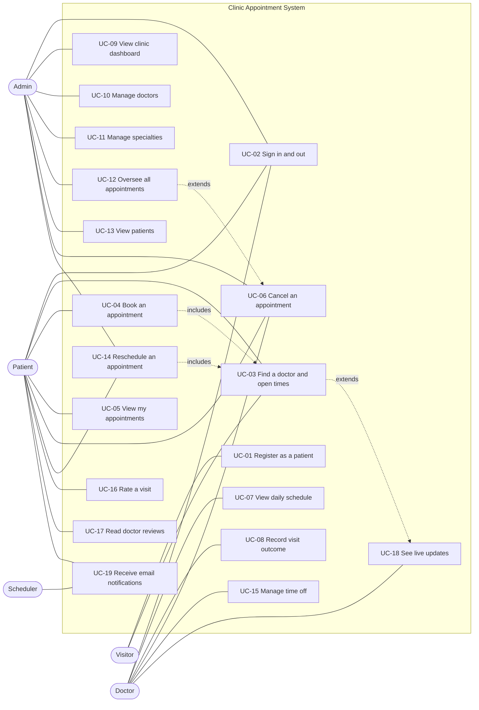

# Use Cases: Clinic Appointment System

This document describes what each type of user can do in the system, step by step, including
what happens when things go wrong. Each use case lists the business rules it depends on and the
automated tests that verify it, so you can trace any requirement straight to its test.

## Contents

1. [Actors](#1-actors)
2. [Use case diagram](#2-use-case-diagram)
3. [Use case summary](#3-use-case-summary)
4. [Business rules](#4-business-rules)
5. [Detailed use cases](#5-detailed-use-cases)
6. [Non-functional requirements](#6-non-functional-requirements)

---

## 1. Actors

| Actor | Description |
|---|---|
| **Visitor** | Anyone who opens the site without signing in. Can browse specialties and see a doctor's open times. |
| **Patient** | A registered person who books and manages their own appointments. |
| **Doctor** | Clinic staff whose account is created by an admin. Works through their own daily schedule. |
| **Admin** | Clinic manager. Manages doctors and specialties and can see and act on every appointment. |
| **System** | The API itself, which enforces the rules (for example, refusing a double booking). |
| **Scheduler** | A background job inside the API that runs every 15 minutes and sends appointment reminders. |

## 2. Use case diagram

## 3. Use case summary

| ID | Use case | Primary actor | Priority |
|---|---|---|---|
| UC-01 | Register as a patient | Visitor | High |
| UC-02 | Sign in and sign out | Patient, Doctor, Admin | High |
| UC-03 | Find a doctor and see open times | Visitor, Patient | High |
| UC-04 | Book an appointment | Patient | High |
| UC-05 | View my appointments | Patient | High |
| UC-06 | Cancel an appointment | Patient, Doctor, Admin | High |
| UC-07 | View daily schedule | Doctor | High |
| UC-08 | Record a visit outcome | Doctor, Admin | Medium |
| UC-09 | View the clinic dashboard | Admin | Medium |
| UC-10 | Manage doctors | Admin | High |
| UC-11 | Manage specialties | Admin | Medium |
| UC-12 | Oversee all appointments | Admin | Medium |
| UC-13 | View patients | Admin | Low |
| UC-14 | Reschedule an appointment | Patient, Admin | High |
| UC-15 | Manage time off | Doctor | High |
| UC-16 | Rate a visit | Patient | Medium |
| UC-17 | Read doctor reviews | Visitor, Patient | Medium |
| UC-18 | See live updates | Patient, Doctor | Medium |
| UC-19 | Receive email notifications | Patient, Scheduler | Medium |

## 4. Business rules

These rules are enforced by the API, not just the screens, so they can't be bypassed by calling
the API directly.

| ID | Rule |
|---|---|
| BR-01 | An email address can belong to only one account. Emails are compared ignoring case and surrounding spaces. |
| BR-02 | Passwords are at least 6 characters and are stored only as BCrypt hashes. |
| BR-03 | Sign-in failures give the same message whether the email or the password was wrong, so the system doesn't reveal which emails are registered. |
| BR-04 | Appointments can only be booked for a time in the future. |
| BR-05 | Appointments can only be booked on the doctor's working days. |
| BR-06 | An appointment must start and end within the doctor's working hours and start on a slot boundary (for example, every 30 minutes from 09:00). |
| BR-07 | A doctor can have only one active (not cancelled) appointment per time slot. This is enforced in code and by a filtered unique database index, so it holds even when two people book at the same moment. |
| BR-08 | A patient can't hold two scheduled appointments that overlap in time, even with different doctors. |
| BR-09 | Only scheduled appointments can be cancelled. Patients can't cancel appointments whose start time has passed; doctors and admins can. |
| BR-10 | A visit can be marked Completed or No-show only once its start time has passed. |
| BR-11 | Completed, No-show and Cancelled are final. A finished appointment can't be changed again. |
| BR-12 | Inactive doctors can't sign in, don't appear in booking, and can't be booked. Their past appointments are kept. |
| BR-13 | A doctor's working hours must end after they start and must fit at least one slot. Working days are 0 (Sunday) to 6 (Saturday). |
| BR-14 | Specialty names are unique. A specialty that still has doctors (active or inactive) can't be deleted. |
| BR-15 | Each role can only use its own features: patients book, doctors manage their schedule, admins manage the clinic. |
| BR-16 | Patients see only their own appointments; doctors see only appointments with them. Admins see everything. |
| BR-17 | Only scheduled appointments that haven't started can be rescheduled, and only to an open slot with the same doctor that passes every booking rule (BR-04 to BR-08, BR-19). |
| BR-18 | A patient can move the same appointment at most 2 times. Admins aren't limited, and their moves don't count toward the patient's limit. Doctors can't reschedule. |
| BR-19 | A doctor can't be booked on a day they're on leave. Those days show no slots. |
| BR-20 | Leave can't start in the past, must end on or after its first day, can last at most 60 days, and can't overlap other leave for the same doctor. |
| BR-21 | Leave can't be added over days where the doctor still has scheduled appointments. Those patients must be moved or cancelled first, so nobody is silently dropped. |
| BR-22 | Only the patient who attended can review a visit, only once it's Completed, only once per visit, and within 30 days. Ratings are whole numbers from 1 to 5. |
| BR-23 | Reviews show the patient as first name and surname initial (for example "Rahul V."), never their full name or contact details. |
| BR-24 | Each scheduled appointment gets one reminder email about 24 hours before it starts. Moving an appointment resets this so the new time gets its own reminder. |
| BR-25 | Patients are emailed when an appointment is booked, moved or cancelled, and asked for a review when it's completed. |
| BR-26 | A failed email or live update never undoes or blocks the action that caused it. Emails are retried up to 3 times. |

---

## 5. Detailed use cases

Step numbers show the order of the main flow. Alternate flows are numbered after the step where
they branch off (for example, **4a** branches from step 4).

### UC-01 Register as a patient

| | |
|---|---|
| **Primary actor** | Visitor |
| **Goal** | Create a patient account so they can book appointments. |
| **Preconditions** | The visitor is not signed in. |
| **Trigger** | The visitor selects **Create account** or **Book an appointment** on the home page. |

**Main flow**

1. The system shows the registration form: full name, email, password, and optional phone, date of birth and gender.
2. The visitor fills in the form and selects **Create account**.
3. The system checks the form (valid email, password of at least 6 characters, phone with digits only).
4. The system checks that no account uses this email (BR-01).
5. The system creates the user with a hashed password (BR-02) and a linked patient record.
6. The system signs the new patient in and opens the booking page.

**Alternate flows**

- **3a. Form is invalid.** The system highlights each invalid field with a message and doesn't send the request.
- **4a. Email already registered.** The system shows "An account with this email already exists." and keeps the form filled in.

**Postconditions:** A patient account exists and the patient is signed in.

**Business rules:** BR-01, BR-02

**Tests:** `AuthServiceTests.Register_*` (4), `AuthEndpointsTests.Register_*` (3), `RegisterComponent` spec (4)

---

### UC-02 Sign in and sign out

| | |
|---|---|
| **Primary actor** | Patient, Doctor or Admin |
| **Goal** | Access their own workspace. |
| **Preconditions** | The user has an account. |
| **Trigger** | The user selects **Sign in**, or opens a protected page while signed out. |

**Main flow**

1. The system shows the sign-in form, with demo accounts that can be filled in with one click.
2. The user enters their email and password and selects **Sign in**.
3. The system verifies the password against the stored hash.
4. The system issues a signed JWT containing the user's ID, name, email and role, valid for 2 hours.
5. The app stores the token and opens the user's workspace: **My appointments** for patients, **My schedule** for doctors, **Overview** for admins.
6. Later, the user selects **Sign out**. The app deletes the token and returns to the sign-in page.

**Alternate flows**

- **2a. User was sent here from a protected page.** After signing in, the app returns them to that page instead of their default workspace.
- **3a. Wrong email or password.** The system shows "Email or password is incorrect." (BR-03).
- **3b. Doctor account is inactive.** The system refuses sign-in and asks them to contact the clinic admin (BR-12).
- **5a. Token expires or is rejected later.** On the next API call the app signs the user out and shows the sign-in page.
- **5b. Signed-in user opens the sign-in or register page.** The app sends them to their workspace instead.
- **5c. User opens a page for another role.** The app sends them to their own workspace (BR-15).

**Postconditions:** The user is signed in with a valid token, or signed out with no stored token.

**Business rules:** BR-03, BR-12, BR-15

**Tests:** `AuthServiceTests.Login_*` (8), `TokenServiceTests` (3), `AuthEndpointsTests.Login_*` and `Me_*` (6), `AuthService` spec (9), `authInterceptor` spec (5), route guards spec (6), `LoginComponent` spec (5)

---

### UC-03 Find a doctor and see open times

| | |
|---|---|
| **Primary actor** | Patient (visitors can use the same API) |
| **Goal** | Find a suitable doctor and see which times are free. |
| **Preconditions** | At least one specialty has an active doctor. |
| **Trigger** | The patient opens **Book a visit**. |

**Main flow**

1. The system lists specialties. Specialties with no active doctors are shown but can't be selected.
2. The patient chooses a specialty.
3. The system lists that specialty's active doctors with experience, fee, working days and hours.
4. The patient chooses a doctor.
5. The system shows the next 14 days. Days the doctor doesn't work are disabled (BR-05).
6. The system selects the first working day and shows its time slots, generated from the doctor's hours and slot length.
7. Slots that are already booked or have already passed are shown struck through and can't be selected (BR-04, BR-07).
8. The patient can choose a different day to see its slots.

**Alternate flows**

- **3a. No doctors in the specialty.** The system shows "No doctors are available in this specialty right now."
- **6a. No times on the chosen day.** The system shows "No times on this day. Try another date."
- **8a. Patient changes specialty or doctor.** The chosen day and time are cleared.

**Postconditions:** The patient sees accurate availability. Nothing is saved.

**Business rules:** BR-04, BR-05, BR-06, BR-07, BR-12

**Tests:** `DoctorServiceTests.GetSlots_*` (10), `DoctorServiceTests.GetAll_*` (3), `AppointmentEndpointsTests.Slots_AreAvailableWithoutSigningIn`, `BookAppointmentComponent` spec (8 of 12)

---

### UC-04 Book an appointment

| | |
|---|---|
| **Primary actor** | Patient |
| **Goal** | Reserve a time with a doctor. |
| **Preconditions** | The patient is signed in and has completed UC-03 up to choosing a free slot. |
| **Trigger** | The patient selects an open time. |

**Main flow**

1. The system highlights the chosen time and shows a summary: date, time, doctor and specialty.
2. The patient writes the reason for the visit. **Book appointment** stays disabled until the reason is at least 3 characters.
3. The patient selects **Book appointment**.
4. The system checks that the time is in the future (BR-04), on a working day (BR-05), inside working hours and on a slot boundary (BR-06).
5. The system checks the doctor has no active appointment at that time (BR-07).
6. The system checks the patient has no overlapping scheduled appointment (BR-08).
7. The system saves the appointment as **Scheduled**.
8. The app shows a confirmation with the date, time and doctor, and links to **My appointments**.

**Alternate flows**

- **4a. Time is invalid** (past, outside hours, wrong day or not on a slot boundary). The system rejects the request with a message explaining why. The screens prevent this, so it mainly protects the API from direct calls.
- **4b. Doctor was deactivated meanwhile.** The system responds that the doctor wasn't found.
- **5a. Someone else just took the slot.** The system responds "This time slot was just booked. Pick another slot." The app shows the message, clears the chosen time and reloads the slots.
- **5b. Two patients submit the same slot at the same instant.** Both pass step 5, but the database's unique index rejects the second save. The system returns the same message as 5a (BR-07).
- **6a. Patient already has an overlapping visit.** The system responds "You already have an appointment that overlaps this time."
- **8a. Patient selects Book another.** The flow starts again from UC-03 step 1.

**Postconditions:** A Scheduled appointment exists, and the slot shows as taken to everyone.

**Business rules:** BR-04 to BR-08, BR-12, BR-15

**Tests:** `AppointmentServiceTests.Book_*` (20), `AppointmentEndpointsTests` booking tests (5), `BookAppointmentComponent` spec (4 of 12)

---

### UC-05 View my appointments

| | |
|---|---|
| **Primary actor** | Patient |
| **Goal** | See upcoming visits and history. |
| **Preconditions** | The patient is signed in. |
| **Trigger** | The patient opens **My appointments** (the default page after sign-in). |

**Main flow**

1. The system returns the patient's own appointments only (BR-16).
2. The **Upcoming** tab lists future scheduled visits, soonest first, with date, time, doctor, specialty and reason.
3. The patient switches to **Past and cancelled** to see completed, no-show, cancelled and past visits.
4. For completed visits, the doctor's notes are shown.

**Alternate flows**

- **2a. No upcoming visits.** The system shows "You have no upcoming visits." with a button to book one.

**Postconditions:** None. This is read-only.

**Business rules:** BR-16

**Tests:** `AppointmentServiceTests.GetForPatient_*`, `AppointmentServiceTests.GetById_*` (5), `AppointmentEndpointsTests.Patient_ViewingAnotherPatientsAppointment_Returns403`, `MyAppointmentsComponent` spec (6 of 9)

---

### UC-06 Cancel an appointment

| | |
|---|---|
| **Primary actor** | Patient (also Doctor and Admin) |
| **Goal** | Free up a booked time that is no longer needed. |
| **Preconditions** | The user is signed in and can see the appointment (BR-16). |
| **Trigger** | The user selects **Cancel** on a scheduled appointment. |

**Main flow**

1. The app asks the user to confirm the cancellation.
2. The user confirms.
3. The system checks the user may act on this appointment (BR-16).
4. The system checks the appointment is still Scheduled and, for patients, hasn't started (BR-09).
5. The system marks the appointment **Cancelled**.
6. The slot becomes available to other patients again (BR-07), and the appointment moves to the patient's **Past and cancelled** tab.

**Alternate flows**

- **2a. User doesn't confirm.** Nothing changes.
- **3a. Appointment belongs to someone else.** The system refuses with "You don't have access to this appointment."
- **4a. Appointment is already finished or cancelled.** The system refuses and states its current status.
- **4b. Patient tries to cancel a past appointment.** The system refuses with "Past appointments can't be cancelled."

**Postconditions:** The appointment is Cancelled and its slot is free.

**Business rules:** BR-07, BR-09, BR-16

**Tests:** `AppointmentServiceTests.Cancel_*` and `Book_SlotFreedByCancellation_*` (8), `AppointmentEndpointsTests.Patient_CancelsBooking_SlotOpensAgain`, `MyAppointmentsComponent` spec (3 of 9), `AdminAppointmentsComponent` spec (1 of 3)

---

### UC-07 View daily schedule

| | |
|---|---|
| **Primary actor** | Doctor |
| **Goal** | See who is coming in on a given day. |
| **Preconditions** | The doctor is signed in. |
| **Trigger** | The doctor opens **My schedule** (the default page after sign-in). |

**Main flow**

1. The system shows today's date, the doctor's clinic hours, and their appointments for today in time order (BR-16).
2. Each appointment shows the time, patient name and phone, reason and status.
3. A summary shows how many are booked and how many are still to be seen.
4. The doctor moves to the previous or next day, picks a date, or returns to today.

**Alternate flows**

- **1a. No appointments on the day.** The system shows "No appointments on this day." with a button to check the next day.

**Postconditions:** None. This is read-only.

**Business rules:** BR-15, BR-16

**Tests:** `AppointmentServiceTests.GetForDoctor_*` (2), `AppointmentEndpointsTests.Doctor_SeesNewBookingInSchedule`, `AppointmentEndpointsTests.Patient_CallingDoctorSchedule_Returns403`, `ScheduleComponent` spec (4 of 9)

---

### UC-08 Record a visit outcome

| | |
|---|---|
| **Primary actor** | Doctor (Admin can also do this) |
| **Goal** | Record what happened at the appointment. |
| **Preconditions** | UC-07. The appointment is Scheduled and its start time has passed. |
| **Trigger** | The doctor selects **Complete visit** or **No-show**. |

**Main flow**

1. The doctor selects **Complete visit**.
2. The app opens a notes box for diagnosis, advice or follow-up.
3. The doctor writes notes and selects **Mark completed**.
4. The system checks the appointment belongs to this doctor (BR-16), is still Scheduled (BR-11) and has started (BR-10).
5. The system saves the status **Completed** and the notes.
6. The patient sees the notes under **Past and cancelled** (UC-05).

**Alternate flows**

- **1a. Patient didn't arrive.** The doctor selects **No-show**. The system saves No-show without notes.
- **1b. Appointment hasn't started yet.** **Complete visit** and **No-show** aren't shown; only **Cancel** is (UC-06). If called directly, the API refuses (BR-10).
- **4a. Appointment already has an outcome.** The system refuses: "This appointment is already Completed." (BR-11).
- **4b. Another doctor's appointment.** The system refuses (BR-16).
- **4c. Patient tries to change the status.** The system refuses (BR-15).

**Postconditions:** The appointment is Completed or No-show, and can't be changed again.

**Business rules:** BR-10, BR-11, BR-15, BR-16

**Tests:** `AppointmentServiceTests.UpdateStatus_*` (12), `ScheduleComponent` spec (5 of 9)

---

### UC-09 View the clinic dashboard

| | |
|---|---|
| **Primary actor** | Admin |
| **Goal** | Get a quick picture of today and of overall activity. |
| **Preconditions** | The admin is signed in. |
| **Trigger** | The admin opens **Overview** (the default page after sign-in). |

**Main flow**

1. The system shows: visits today (not counting cancelled), upcoming scheduled visits, completed, cancelled, active doctors and total patients.
2. The system lists today's appointments in time order with patient, doctor, reason and status.
3. The admin can open **All appointments** (UC-12).

**Alternate flows**

- **2a. No appointments today.** The table shows "No appointments today."

**Postconditions:** None. This is read-only.

**Business rules:** BR-15

**Tests:** `AdminServiceTests.GetStats_*` (2), `AdminEndpointsTests.Admin_GetsStats`, `AdminEndpointsTests.NonAdmin_CallingAdminEndpoints_Returns403` (2)

---

### UC-10 Manage doctors

| | |
|---|---|
| **Primary actor** | Admin |
| **Goal** | Add doctors, keep their details and hours up to date, and deactivate those who leave. |
| **Preconditions** | The admin is signed in. At least one specialty exists. |
| **Trigger** | The admin opens **Doctors**. |

**Main flow (add a doctor)**

1. The system lists all doctors, active and inactive, with specialty, hours and fee.
2. The admin selects **Add doctor**.
3. The admin enters name, specialty, sign-in email, temporary password, phone, experience, fee, start and end time, slot length, working days and bio.
4. The admin selects **Add doctor**.
5. The system checks the email is unused (BR-01), the specialty exists, and the hours and days are valid (BR-13).
6. The system creates the doctor's sign-in account and profile. Duplicate working days are removed and the days are sorted.
7. The list refreshes. The doctor can now sign in and patients can book them.

**Alternate flow (edit or deactivate)**

- **2a.** The admin selects **Edit** on a doctor. The form opens with their details. The sign-in email and password can't be changed here.
- **2b.** The admin changes details or clears **Accepting appointments**, then selects **Save changes**.
- **2c.** A deactivated doctor can't sign in or be booked, and is hidden from patients (BR-12).

**Exception flows**

- **5a. No working days chosen.** The app shows "Pick at least one working day." and doesn't send the request.
- **5b. Email already in use.** The system responds "An account with this email already exists."
- **5c. Invalid hours.** For example, end before start, or a day shorter than one slot. The system explains the problem (BR-13).
- **5d. Time not in HH:mm format.** The system responds "Use HH:mm format."

**Postconditions:** The doctor is saved with valid hours. Their availability in UC-03 reflects the change immediately.

**Business rules:** BR-01, BR-12, BR-13, BR-15

**Tests:** `DoctorServiceTests.Create_*` and `Update_*` (11), `AdminEndpointsTests.Admin_CreatesDoctor_WhoCanThenSignIn`, `AdminEndpointsTests.Admin_CreateDoctorWithBadTimeFormat_Returns400`, `AuthServiceTests.Login_InactiveDoctor_ThrowsForbidden`, `DoctorsComponent` spec (8)

---

### UC-11 Manage specialties

| | |
|---|---|
| **Primary actor** | Admin |
| **Goal** | Keep the list of specialties patients choose from up to date. |
| **Preconditions** | The admin is signed in. |
| **Trigger** | The admin opens **Specialties**. |

**Main flow**

1. The system lists specialties alphabetically with the number of active doctors in each.
2. The admin enters a name and optional description and selects **Add specialty**.
3. The system checks the name is unique (BR-14) and saves it.
4. The new specialty appears in the list and on the booking page.

**Alternate flows**

- **2a. Edit.** The admin selects **Edit**, changes the name or description, and selects **Save changes**.
- **2b. Delete.** The admin selects **Delete** and confirms. The system removes the specialty if it has no doctors.
- **3a. Name already used.** The system responds that the specialty already exists.
- **2b-1. Specialty still has doctors.** The system refuses: "Reassign this specialization's doctors before deleting it."

**Postconditions:** The specialty list is updated.

**Business rules:** BR-14, BR-15

**Tests:** `SpecializationServiceTests` (10), `AdminEndpointsTests.Anonymous_GetSpecializations_ReturnsSeededList`, `AdminEndpointsTests.Admin_DeleteSpecialtyWithDoctors_Returns400`, `SpecializationsComponent` spec (4)

---

### UC-12 Oversee all appointments

| | |
|---|---|
| **Primary actor** | Admin |
| **Goal** | Find any appointment and act on it if needed. |
| **Preconditions** | The admin is signed in. |
| **Trigger** | The admin opens **Appointments**. |

**Main flow**

1. The system lists all appointments, newest first.
2. The admin filters by status, doctor and/or day and selects **Apply filters**.
3. The system returns only matching appointments.
4. The admin can cancel any scheduled appointment (UC-06).

**Alternate flows**

- **2a. Admin selects Clear.** All filters are removed and the full list reloads.
- **3a. Nothing matches.** The table shows "No appointments match these filters."

**Postconditions:** None, unless an appointment was cancelled.

**Business rules:** BR-15, BR-16

**Tests:** `AppointmentServiceTests.GetAll_*` (4), `AdminAppointmentsComponent` spec (3)

---

### UC-13 View patients

| | |
|---|---|
| **Primary actor** | Admin |
| **Goal** | Look up a patient's contact details and visit count. |
| **Preconditions** | The admin is signed in. |
| **Trigger** | The admin opens **Patients**. |

**Main flow**

1. The system lists patients alphabetically with email, phone, date of birth, gender and number of appointments.
2. The admin types part of a name or email and selects **Search**.
3. The system shows matching patients.

**Alternate flows**

- **3a. No match.** The table shows "No patients found."

**Postconditions:** None. This is read-only.

**Business rules:** BR-15

**Tests:** `AdminServiceTests.GetPatients_*` (4), `AdminEndpointsTests.NonAdmin_CallingAdminEndpoints_Returns403`

---

### UC-14 Reschedule an appointment

| | |
|---|---|
| **Primary actor** | Patient (Admin can also do this) |
| **Goal** | Move an upcoming visit to another time with the same doctor without losing it. |
| **Preconditions** | The appointment is Scheduled and hasn't started. The patient has moved it fewer than 2 times. |
| **Trigger** | The patient selects **Reschedule** in **My appointments**, or an admin selects **Move** in **All appointments**. |

**Main flow**

1. The system shows the current time and the doctor, with the slot picker for the same doctor (UC-03).
2. The current time is marked "current" and can't be chosen. Leave days and taken times are disabled.
3. The patient picks a new time. The summary shows **Currently → New time**.
4. The patient selects **Move appointment**.
5. The system checks access (BR-16), status and start time (BR-17), the patient's move limit (BR-18), and every booking rule for the new time, ignoring the appointment's own current slot.
6. The system saves the new start and end times, adds one to the patient's move count, and clears the reminder flag (BR-24).
7. The old slot becomes free and the new one taken for everyone watching (UC-18). The doctor is notified, and the patient gets an email with the old time struck through (UC-19).
8. The app returns to the appointments list with a confirmation message.

**Alternate flows**

- **1a. Appointment can't be moved** (not scheduled, already started, or moved twice by the patient). The page explains why and doesn't show the picker.
- **5a. Someone took the new time meanwhile.** "This time slot was just booked. Pick another slot." The picker refreshes.
- **5b. Patient has another appointment at the new time.** The system refuses (BR-08).
- **5c. Doctor tries to reschedule.** The system refuses (BR-18).
- **8a. Patient selects Keep current time.** Nothing changes.

**Postconditions:** The appointment has a new time, and both slots show the right availability.

**Business rules:** BR-04 to BR-08, BR-16 to BR-19, BR-24

**Tests:** `RescheduleTests` (19), `FeatureEndpointsTests` reschedule tests (2), `RescheduleComponent` spec (7), `MyAppointmentsComponent` spec (1), `AdminAppointmentsComponent` spec (1)

---

### UC-15 Manage time off

| | |
|---|---|
| **Primary actor** | Doctor |
| **Goal** | Block days when they're away so patients can't book them. |
| **Preconditions** | The doctor is signed in. |
| **Trigger** | The doctor opens **Time off**. |

**Main flow**

1. The system lists the doctor's current and upcoming leave with dates, length and reason.
2. The doctor chooses a first day, a last day (which moves forward automatically if it's before the first day) and an optional reason.
3. The doctor selects **Add leave**.
4. The system checks the dates (BR-20) and that no scheduled appointments fall in the period (BR-21).
5. The system saves the leave.
6. Patients viewing this doctor see those days change to **Leave** immediately (UC-18), and the API refuses bookings on them (BR-19).

**Alternate flows**

- **2a. Doctor removes leave.** The doctor selects **Remove** and confirms. The days open for booking again and watchers are updated.
- **4a. Dates invalid** (in the past, end before start, longer than 60 days). The system explains the problem.
- **4b. Overlaps existing leave.** "This overlaps leave you've already added."
- **4c. Patients already booked.** "You have 2 scheduled appointments in this period. Ask the clinic admin to move or cancel them first." The admin uses UC-14 or UC-06, then the doctor tries again.

**Postconditions:** The leave is saved and those days can't be booked.

**Business rules:** BR-19, BR-20, BR-21

**Tests:** `LeaveServiceTests` (15), `RescheduleTests.Reschedule_OntoDoctorsLeave_ThrowsBadRequest`, `FeatureEndpointsTests` leave tests (2), `LeaveComponent` spec (6), `SlotPickerComponent` spec (2)

---

### UC-16 Rate a visit

| | |
|---|---|
| **Primary actor** | Patient |
| **Goal** | Share how a visit went, to help other patients choose. |
| **Preconditions** | The visit is Completed, belongs to the patient, isn't yet reviewed, and was within the last 30 days. |
| **Trigger** | The patient selects **Rate this visit** under **Past and cancelled**, or follows the link in the review-request email (UC-19), which opens that tab directly. |

**Main flow**

1. The app shows a 1 to 5 star selector and an optional comment box, noting the comment is shown to other patients.
2. The patient chooses a rating, optionally writes a comment, and selects **Submit review**.
3. The system checks the rules (BR-22) and saves the review.
4. The visit now shows **You rated ★★★★☆**, and the doctor's average rating updates everywhere.

**Alternate flows**

- **2a. No stars chosen.** The app asks the patient to choose from 1 to 5 stars and doesn't send the request.
- **2b. Patient selects Not now.** The form closes. They can rate later within the 30 days.
- **3a. Already reviewed, not completed, someone else's visit, or too late.** The system refuses with a reason.

**Postconditions:** One review exists for the visit.

**Business rules:** BR-22, BR-23

**Tests:** `ReviewServiceTests.Create_*` (11), `FeatureEndpointsTests` review tests (2), `MyAppointmentsComponent` spec (4)

---

### UC-17 Read doctor reviews

| | |
|---|---|
| **Primary actor** | Patient (visitors can use the same API) |
| **Goal** | Use other patients' experiences to choose a doctor. |
| **Preconditions** | None. |
| **Trigger** | The patient views doctors while booking (UC-03). |

**Main flow**

1. Each doctor card shows the average rating (to one decimal place) and number of reviews, or "no reviews yet".
2. The patient selects **Read reviews**.
3. The system shows the 5 most recent reviews: stars, reviewer as "First name, initial" (BR-23), month, and comment.
4. The patient selects **Hide reviews**, or picks the doctor.

**Postconditions:** None. This is read-only. Doctors also see their own average on **My schedule**, and admins see each doctor's rating in **Doctors**.

**Business rules:** BR-23

**Tests:** `ReviewServiceTests.GetForDoctor_*`, `DoctorProfile_*` and `PublicName_*` (8), `BookAppointmentComponent` spec (2), `StarsComponent` spec (2)

---

### UC-18 See live updates

| | |
|---|---|
| **Primary actor** | Patient, Doctor |
| **Goal** | See accurate availability and schedules without reloading the page. |
| **Preconditions** | The browser can reach the API's real-time endpoint (`/hubs/clinic`). |
| **Trigger** | A patient opens the slot picker (UC-03, UC-14), or a doctor opens **My schedule** (UC-07). |

**Main flow (patient)**

1. The app opens one SignalR connection and starts watching the chosen doctor.
2. Someone else books, moves or cancels with that doctor, or the doctor changes their leave.
3. The API tells everyone watching the doctor which date changed.
4. If that's the date on screen, the app reloads the times and shows **Updated just now**. Leave days update too.
5. If the time the patient had picked was just taken, it's cleared so they can't try to book it.

**Main flow (doctor)**

1. When the doctor signs in and opens **My schedule**, the connection joins their private schedule channel using their token.
2. A patient books, moves or cancels.
3. A short message appears, for example "New booking: Asha Rao, Tue 20 Oct, 10:30".
4. If the change affects the day on screen, the list reloads.

**Alternate flows**

- **1a. Real-time connection unavailable.** Everything still works; the page just doesn't refresh on its own, and the API still refuses double bookings (BR-07).
- **1b. Connection drops.** The app reconnects automatically and rejoins the doctors it was watching.
- **Sign-out.** The connection closes, so the next user on the device connects with their own identity.

**Postconditions:** None.

**Business rules:** BR-07, BR-26

**Tests:** `AppointmentEventsTests` hub tests (6), `FeatureEndpointsTests.SlotWatcher_IsToldWhenSomeoneBooks`, `FeatureEndpointsTests.Doctor_ReceivesScheduleChangeForNewBooking`, `SlotPickerComponent` spec (4), `ScheduleComponent` spec (4), `RealtimeService` spec (2)

---

### UC-19 Receive email notifications

| | |
|---|---|
| **Primary actor** | Patient (triggered by other use cases and by the Scheduler) |
| **Goal** | Know about every change to an appointment, and be reminded before it. |
| **Preconditions** | The patient has an email address on their account. |
| **Trigger** | A booking, move, cancellation or completion (UC-04, UC-14, UC-06, UC-08), or the reminder job (every 15 minutes). |

**Main flow**

1. After the change is saved, the API puts an email on its queue. The request finishes straight away without waiting for the mail server.
2. A background worker sends the email: confirmation, moved, cancelled, or "How was your visit?" with a link to rate it (UC-16).
3. Every 15 minutes the Scheduler finds scheduled appointments starting within 24 hours that haven't had a reminder, queues one each, and records that it did (BR-24).

**Alternate flows**

- **2a. Mail server unavailable.** The worker retries up to 3 times with increasing waits (BR-26).
- **2b. No mail server configured (development).** Emails are saved as `.eml` files in the API's `emails` folder, which open in any mail app.
- **3a. Appointment moved after its reminder was sent.** The flag is cleared, so a reminder goes out for the new time.

**Postconditions:** The patient has an email for each change and one reminder per appointment time.

**Business rules:** BR-24, BR-25, BR-26

**Tests:** `AppointmentEventsTests` email tests (5), `EmailTemplatesTests` (3), `ReminderJobTests` (5), `EmailDispatcherServiceTests` (2), `RescheduleTests.Reschedule_ResetsReminderSoTheNewTimeGetsOne`, `FeatureEndpointsTests.Booking_SendsConfirmationEmail`

---

## 6. Non-functional requirements

| ID | Requirement | How it's met |
|---|---|---|
| NFR-01 Security | Passwords are never stored or logged in plain text. | BCrypt hashing (BR-02) |
| NFR-02 Security | Every protected API call is authenticated and authorized by role. | JWT bearer tokens, `[Authorize(Roles = ...)]`, ownership checks in services |
| NFR-03 Security | Server errors don't reveal internal details. | `ExceptionMiddleware` returns a generic message for unexpected errors |
| NFR-04 Consistency | Double bookings can't happen, even under concurrent requests. | Filtered unique index on `(DoctorId, StartTime)` (BR-07) |
| NFR-05 Usability | Every error tells the user what went wrong and what to do. | Consistent `{ status, message }` errors shown in the UI |
| NFR-06 Accessibility | Usable by keyboard and by people with low vision. | Visible focus outlines, labelled form fields, Atkinson Hyperlegible typeface, reduced-motion support |
| NFR-07 Responsiveness | Works on phones as well as desktops. | Responsive layouts down to 360px wide |
| NFR-08 Maintainability | Business rules are covered by automated tests. | 233 backend and 147 frontend test cases; see [TESTING.md](TESTING.md) and [TEST_CASES.md](TEST_CASES.md) |
| NFR-09 Responsiveness | Notifications never slow down a request. | Emails go through an in-memory queue and a background worker |
| NFR-10 Freshness | Availability shown to patients is current within about a second of a change. | SignalR push to everyone watching the doctor |
| NFR-11 Privacy | Public reviews don't identify patients. | First name and initial only (BR-23); email addresses never leave the API |
